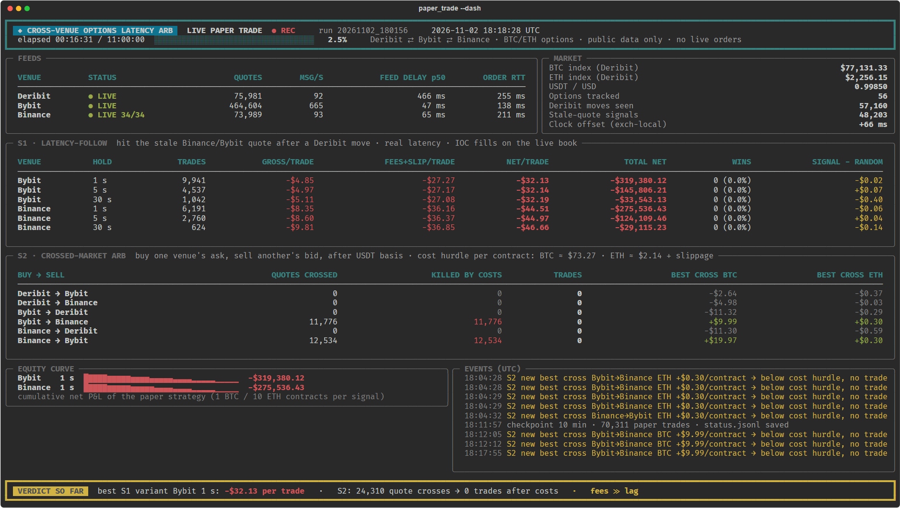

# Do Binance & Bybit options lag Deribit enough to trade?

**Cross-exchange BTC/ETH options latency-arbitrage research — public data, four pass/fail gates, live paper trading.**

[](https://www.linkedin.com/in/ayushk2s)
[](https://github.com/ayushk2s)
[](https://x.com/ayushk2s)
[](https://www.instagram.com/ayushk2s)


> **Verdict: no edge.** The lag is statistically real (p < 0.005) but worth **~$1 per BTC contract**,
> against **~$54** in retail fees and spread to trade it. Two live paper-trading runs: **236,146 trades, 4 winners.**
> The cross-exchange arbitrage version saw **197,866 price crosses and took 0 trades** — every one was smaller than its costs.


<sub>Live terminal (`scripts/05_paper_trade.py --dash`) from run 2: every row 0 wins, every price cross killed by costs.</sub>

---

## 📣 LinkedIn series

| Part | Topic | Link |
|---|---|---|
| 1 | The question and the four-gate plan | [Post 1](https://lnkd.in/p/g9vDqNhR) |
| 2 | Gates 0–2: who moves first, and what the lag is worth | [Post 2](https://lnkd.in/p/eRx6PpWe) |
| 3 | Gate 3: live paper trading and the final verdict | [Post 3](https://lnkd.in/p/eCNGqyC7) |

The full dated research log is in [`STRATEGY_CARD.md`](STRATEGY_CARD.md).

---

## Contents

- [The question](#the-question)
- [Results at a glance](#results-at-a-glance)
- [Method: four gates](#method-four-gates)
- [Gate 0 — connectivity and market structure](#gate-0--connectivity-and-market-structure)
- [Gate 1 — does a lag exist?](#gate-1--does-a-lag-exist)
- [Gate 2 — can this machine win the race?](#gate-2--can-this-machine-win-the-race)
- [Gate 3 — live paper trading](#gate-3--live-paper-trading)
- [Follow-up ideas](#follow-up-ideas-all-dead)
- [Pitfalls worth knowing](#pitfalls-worth-knowing)
- [Limitations](#limitations)
- [Repository layout](#repository-layout)
- [Reproduce it](#reproduce-it)
- [Author](#author)

---

## The question

Deribit holds most of the BTC/ETH options market. Binance and Bybit also list options, and the common
assumption is that they re-quote off Deribit. If they do so **with a delay**, there may be a trade:
see Deribit move, then hit the stale quote on Binance or Bybit before it updates.

Three things all have to be true for that to work:

1. A measurable lag exists between Deribit and the other two exchanges.
2. A retail setup can act inside that lag.
3. The lag is worth more than the spread, fees and slippage of trading it.

This repository tests each one with public market data only. **No API keys, no live orders** — paper
trading means simulating fills against the live order books.

## Results at a glance

| Gate | Question | Result | Key number |
|---|---|---|---|
| 0 | Can I reach all three exchanges, and are the chains liquid? | ✅ PASS (with surprises) | Binance/Bybit ATM spreads $5 vs Deribit $33–82 |
| 1 | Is there a measurable lag? | ❌ FAIL on economics | Real (t = 3.7–6.7) but **$0.33–1.05** per BTC contract |
| 2 | Can this machine win the race? | ❌ FAIL | Deribit's feed lands ~0.5 s after the others |
| 3 | Does anything survive real costs? | ❌ FAIL | **−$20.76 to −$46.41 per trade**, 4 wins in 236,146 |

Three independent reasons it fails — any one is enough:

1. **Deribit isn't the leader.** The perpetual future leads every options exchange, and Binance/Bybit react to it in 50–100 ms.
2. **Retail latency loses the race.** By the time a Deribit update reaches a home connection, Binance/Bybit have already made 65–85 % of their move.
3. **Fees dwarf the lag.** Taker fees (0.03 % of the index per side ≈ $23–25 per BTC contract) are 10–50× any lag or price cross observed.

---

## Method: four gates

Written down before any trading code, with the rule **stop at the first gate that fails**:

| Gate | Test | Pass condition |
|---|---|---|
| 0 | Reach live REST + websocket feeds on Deribit, Binance and Bybit; census the option chains | All reachable, chains liquid |
| 1 | Record all three exchanges simultaneously; lead-lag on exchange timestamps | A lag that is both statistically and economically meaningful |
| 2 | Measure this machine's own round-trip latency | Faster than the lag |
| 3 | Paper-trade live order books with real spreads, fees, slippage and latency, against a random-direction baseline | Positive net edge, statistically distinguishable from noise |

"No edge" counts as a valid result. Gates 1 and 2 failed; Gate 3 was run anyway to put an exact dollar figure on it.

---

## Gate 0 — connectivity and market structure

**Scripts:** `00_connectivity.py`, `00b_binance_ws_probe.py`, `00c_binance_opt_streams.py`, `01_chain_snapshot.py`

**Reachability.** REST worked on all three (200–550 ms cold). Websockets:

| Exchange | Working stream(s) | Notes |
|---|---|---|
| Deribit | `ticker.<instrument>.100ms` | Public feed is batched every 100 ms |
| Bybit | `v5/public/option` tickers + `orderbook.25` | Full book maintained locally |
| Binance | `fstream /public/ws/<lowercase>@bookTicker`, `/market/ws/<und>@optionMarkPrice` | The old `nbstream` options host is retired (404). Upper-case symbols, `@depth`, `@optionTicker`, `@trade` connect but deliver nothing |

**Chains are full, not thin:**

| Exchange | BTC options | ETH options | Expiries | 24h volume BTC | 24h volume ETH |
|---|---|---|---|---|---|
| Deribit | 930 | 784 | 12 | 18.2k | 120k |
| Bybit | 686 | 568 | 11 | 7.0k | 158k |
| Binance | 638 | 528 | 11 | 6.2k | 125k |

Volumes in contracts (1 coin each). Deribit still trades ~2.6× more BTC; on ETH all three are similar.

**The premise check failed.** Near-expiry at-the-money spreads were *tighter* on the "followers":

| | Binance | Bybit | Deribit |
|---|---|---|---|
| BTC ATM spread | $5 (~1 % of price) | $5 (~1 %) | $33–82 (8–15 %) |
| ETH ATM spread | $0.2–0.6 | $0.1–0.2 | ~$2.4 |
| BTC touch size | 8–19 BTC | 4–9 BTC | 1–51 BTC |

Deribit quotes options in BTC with ticks of 0.0001–0.0005 BTC (≈ $8–41).

**Two traps found here** (see [Pitfalls](#pitfalls-worth-knowing)): the USD vs USDT settlement gap, and a local
clock that drifted 330–780 ms behind the exchanges.

---

## Gate 1 — does a lag exist?

**Scripts:** `02_record.py` (recorder), `03_leadlag.py` (cross-correlation + event study), `03b_incremental.py` (regression)

**Data:** 4 hours of synchronized recording — 12 ATM options (BTC/ETH, nearest expiry, 3 strikes, calls and puts)
on all three exchanges, plus the BTC/ETH perpetuals as a control. Timed on **exchange timestamps**, using each
exchange's best bid/ask **mid** (not last trade, which is sparse and noisy on option books). Binance had 112 min of
ISP-level DNS outages (two long gaps of 50 and 45 min plus short drops); those windows are masked.

### Who moves first? The perp.

Cross-correlation of 50 ms-binned mid changes (exchange clock), peak lag and log-likelihood ratio for "A leads B":

| Leader → follower | BTC peak lag | BTC LLR | ETH peak lag | ETH LLR |
|---|---|---|---|---|
| Perp → Bybit options | +50 ms | 13.0 | +50 ms | 10.9 |
| Perp → Binance options | +100 ms | 10.8 | 0 ms | 2.9 |
| Perp → Deribit options | +100 ms* | 14.2 | +100 ms* | 8.8 |
| Deribit → Binance options | +100 ms | 1.3 | −100 ms | 0.5 |
| Deribit → Bybit options | −50 ms | 0.4 | −100 ms | 0.7 |

\* Deribit's public feed is batched every 100 ms, so its +100 ms is an upper bound.

Deribit → follower correlations peak at zero or **negative** lag with LLR < 1.5: the "followers" tend to move
*with or before* Deribit's update, not after it.

**Event study.** On the local clock (what this machine actually sees), when a Deribit move arrives, Binance and
Bybit have already made **65–85 %** of their net move over the window from 5 s before to 10 s after the update.

### Does Deribit add anything beyond the perp? Yes — a tiny amount.

OLS with HAC standard errors, 71k one-second samples over 4 hours. Target: follower mid change over the next
1–5 s; regressors: Deribit's last-second move, the perp's last-second move (signed by call/put), and the
follower's own last-second move.

| Follower | Deribit coefficient t-stat (controlled) | Deribit alone | Perp t-stat |
|---|---|---|---|
| Binance | 3.7 – 5.2 | 8.4 – 10.3 | 3.5 – 5.9 |
| Bybit | 4.1 – 6.7 | 6.4 – 9.9 | 3.5 – 4.1 |

**Circular-shift null:** shifting Deribit's series by random 60–600 s offsets 200 times never reproduced the
observed coefficient (**p < 0.005**). The information is real.

### What is it worth?

After a "pure" Deribit move (Deribit mid moves ≥ ~half a tick while the perp is quiet), the follower's mid
drifts in the same direction by:

| Follower | Coin | Next 1 s | Next 5 s | Events |
|---|---|---|---|---|
| Binance | BTC | $0.37 [0.20, 0.53] | $1.05 [0.67, 1.44] | 2,356 |
| Bybit | BTC | $0.33 [0.20, 0.45] | $0.96 [0.65, 1.27] | 2,356 |
| Binance | ETH | $0.09 [−0.07, 0.27] | $0.19 [0.01, 0.39] | 446 |
| Bybit | ETH | $0.02 [0.01, 0.04] | $0.09 [0.05, 0.13] | 446 |

Against a round trip of **~$54 per BTC contract** ($49 taker fees + $5 spread) and **≥ $1.44** in fees alone
per ETH contract. The lag is worth ~2 % of what it costs to trade.

**Gate 1: statistically real, economically negligible → FAIL.**

---

## Gate 2 — can this machine win the race?

**Script:** `04_latency.py` (no orders — measures warm REST round trips)

| Exchange | Warm REST round trip (p50) |
|---|---|
| Bybit | 138 ms |
| Binance | 211 ms |
| Deribit | 255 ms |

Deribit's option feed lands ~0.5 s after Binance/Bybit's on this connection. Adding the round trip, the earliest
this machine can act on a Deribit move is **~0.7–0.9 s after it happens**. Binance/Bybit market makers watch the
perp from co-located servers; they have re-quoted long before.

**Gate 2: FAIL.**

---

## Gate 3 — live paper trading

**Scripts:** `05_paper_trade.py` (live engine, optional `--dash` terminal view), `06_paper_report.py` (report)
**Engine:** [`src/paper/engine.py`](src/paper/engine.py)

Run anyway, to replace "it probably loses" with an exact figure.

### Strategies

- **S1 — latency follow.** On every Deribit option mid move, if the same option on Binance/Bybit has not moved
  the same way, send an immediate-or-cancel order at the stale price; exit at market after 1 s, 5 s or 30 s.
  Each variant runs alongside a **random-direction null** (same timing, coin-flip side) and a **zero-latency
  oracle** (perfect speed).
- **S2 — crossed-market arbitrage.** Whenever one exchange's ask is below another's bid for the same option
  (after USD/USDT conversion), buy one and sell the other and hold to expiry. Both legs must fill.

### Cost and fill model

| Component | Model |
|---|---|
| Spread | Real — buys at the live ask, sells at the live bid |
| Taker fee | min(0.03 % × index, cap × premium) per contract per side. Caps: Bybit 7 %, Deribit 12.5 %, Binance 10 % (assumed) |
| Slippage | Walk the real book (Bybit 5 levels; Binance/Deribit +1 tick per touch-size) **plus** ½ tick on every fill |
| Latency | Order arrives RTT/2 after the decision (Bybit 69 ms, Binance 105 ms); evaluated only once data up to that exchange time has arrived — no lookahead |
| Size | S1: 1 BTC or 10 ETH contracts per signal, one open position per option per variant. S2: up to 5 BTC / 50 ETH, capped by displayed size |
| S2 extras | Exercise fee 0.015 % of index; 2 bp settlement-index haircut; worst-case USD/USDT strike gap with ±5 bp drift |

Universe: **56 options** — BTC/ETH × 2 nearest expiries × 7 strikes around spot × calls and puts.

### S1 results (real latency)

| Exchange | Hold | Run 1 trades | Run 1 net/trade [95 % CI] | Run 2 trades | Run 2 net/trade [95 % CI] |
|---|---|---|---|---|---|
| Bybit | 1 s | 92,348 | **−$20.76** [−21.19, −20.34] | 10,886 | **−$32.08** [−32.38, −31.77] |
| Bybit | 5 s | 41,897 | −$20.93 | 4,965 | −$32.10 |
| Bybit | 30 s | 9,980 | −$21.30 | 1,145 | −$32.18 |
| Binance | 1 s | 41,443 | **−$34.94** [−35.59, −34.31] | 6,759 | **−$44.43** [−45.01, −43.91] |
| Binance | 5 s | 18,597 | −$35.24 | 3,017 | −$45.01 |
| Binance | 30 s | 4,423 | −$35.99 | 686 | −$46.41 |

- Run 1: 3 hours. Run 2: planned overnight, stopped after 18 minutes — the result was not going to change.
- CIs are 1-minute cluster bootstraps (trades overlap in time, so i.i.d. intervals would be too narrow).
- **Winners: 4 out of 236,146 trades** across both runs (all four in Bybit 30 s, run 1).
- **Before costs the average trade already loses $4–8** — every round trip crosses the spread.
- **Signal vs random direction:** +$0.02 to +$0.06 per trade in run 1 (only Bybit 1 s significant, p = 0.002 —
  the same tiny Deribit information found in Gate 1); not significant in any run-2 variant (p ≥ 0.37).
- **Zero-latency oracle:** no better (run 1 Bybit 1 s −$22.56, Binance 1 s −$35.37).
- **Why run 2 was worse:** options were ~3× pricier that day (Bybit BTC average premium $504 vs $172), so the
  7 % premium fee cap stopped binding — fees rose from $20.4 to $34.9 per BTC trade. Gross before costs was
  similar (−$7.4 vs −$6.1). Same strategy, worse economics.

### S2 results

| | Run 1 | Run 2 |
|---|---|---|
| Binance ↔ Bybit quote updates crossed | 171,124 | 26,742 |
| Killed by costs | 100 % | 100 % |
| Largest BTC cross | $39.93 | $19.97 |
| BTC cost hurdle | ≈ $82 | ≈ $73 + slippage |
| Largest ETH cross | $1.10 | $0.40 |
| Deribit ↔ Binance/Bybit crosses (after USDT conversion) | 9, all killed | 0 |
| **Trades** | **0** | **0** |

Crosses are 1–2-tick transients at about half the cost of trading them.

**Gate 3: NO EDGE.**

---

## Follow-up ideas (all dead)

**1. Full-chain scan incl. cheap wings** — `07_wing_scan.py`.
~4,100 options per 20 s snapshot across all three exchanges, with premium-capped fees, delta-weighted exercise fees
and the USDT strike gap. ~140 net-positive crosses per snapshot — **all** 4–11-month deep in-the-money options, one
direction (buy Deribit, sell Bybit). That is interest-rate carry between Deribit's inverse options and Bybit's
USDT discounting: **3.1–3.3 % a year** on the premium paid, roughly **1–3 %** once margin on the short leg is included —
a money-market-like return with a year of two-exchange counterparty risk. Under 30 days to expiry: 2 crosses in 10 minutes, both minimum-tick artifacts worth $4.85 in total.

**2. Expiry settlement mispricing.** Deribit dailies settle on a 07:30–08:00 UTC index TWAP, but the expiring
daily barely trades in its final hour. Testing it needs weeks of live recording in that window — not backtestable
from free data.

**3. Maker-side quoting.** Retail maker fees (~$16 per BTC contract per side) exceed the $5 touch spread. Only
viable inside an exchange market-maker programme with rebates.

**4. Polymarket "Bitcoin above $K" vs Deribit-implied probability** — `08_polymarket_vs_deribit.py`.
Fair probability from Deribit's smile (variance interpolated between bracketing expiries, USDT strike conversion,
smile-slope digital correction). Polymarket mids showed no systematic bias (average signed deviation −0.1 to −0.4¢ per event); the average absolute
deviation was 0.5–2.7¢ per event, max 4.4¢, concentrated at the strikes nearest spot — within model error (Polymarket resolves on one Binance 1-minute close at 12:00 ET; Deribit settles on
an 08:00 UTC TWAP). Intra-Polymarket monotonicity arbitrage: 0. Capacity ~$10–50/day.

---

## Pitfalls worth knowing

- **USD ≠ USDT.** Deribit settles on a USD index; Binance and Bybit on a USDT index (USDT ≈ 0.9988 USD here).
  A USDT strike K pays like a USD strike p·K — about $100 apart on BTC. Skip the conversion and Deribit vs Bybit
  shows fake $20–35 "crosses" all day; after it, they never crossed.
- **Your clock lies.** The local Windows clock ran 330–780 ms behind the exchanges and drifted. All timing uses
  exchange timestamps, with the local offset re-measured every minute.
- **Batched feeds hide ordering.** Deribit's public ticker is batched every 100 ms, so sub-100 ms ordering claims
  about Deribit can't be made from it.
- **Fee caps change the answer.** Option fees are capped at a percentage of premium; on cheap options the cap binds
  and fees fall. The same strategy lost $11/trade more on a day when options were pricier.
- **Network-level outages.** The ISP's DNS intermittently blocked Binance during recording. Outage windows are
  detected (Binance perp > 5 s stale) and masked rather than bypassed.

## Limitations

- Retail fee tier only. VIP or market-maker tiers are lower — but the lag ($1) is far below even the spread ($5).
- Binance's premium fee cap (10 %) is assumed, not verified.
- Binance and Deribit order-book depth beyond the touch is synthetic (+1 tick per touch-size); Bybit uses real depth.
- One 4-hour recording and two paper-trading runs (3 h and 18 min) on two different days.
- Binance's BTC/ETH perpetual is the "underlying" control for all three exchanges.
- Absolute feed delays depend on the clock-offset estimate; relative delays between exchanges are robust.

---

## Repository layout

```
.
├── STRATEGY_CARD.md          hypothesis, gate plan, stop/go rules, dated results log
├── scripts/                  numbered pipeline — run in order
│   ├── 00_connectivity.py        Gate 0: REST/WS reachability on all three exchanges
│   ├── 00b_binance_ws_probe.py   which Binance option streams actually deliver
│   ├── 00c_binance_opt_streams.py
│   ├── 01_chain_snapshot.py      chain census, ATM spreads and depth
│   ├── 02_record.py              Gate 1: synchronized multi-exchange recorder
│   ├── 03_leadlag.py             Gate 1: cross-correlation + event study
│   ├── 03b_incremental.py        Gate 1: HAC regression + circular-shift null
│   ├── 04_latency.py             Gate 2: round-trip latency
│   ├── 05_paper_trade.py         Gate 3: live paper trading (--dash for the terminal view)
│   ├── 06_paper_report.py        Gate 3: report with cluster-bootstrap CIs and permutation tests
│   ├── 07_wing_scan.py           follow-up 1: full-chain crossed-market scan
│   └── 08_polymarket_vs_deribit.py  follow-up 4: Polymarket digitals vs Deribit smile
├── src/
│   ├── clients/feeds.py      public websocket feeds (Deribit, Binance, Bybit), auto-reconnect
│   └── paper/
│       ├── engine.py         latency-aware fill engine, fee/slippage model, S1 + S2
│       └── dash.py           live terminal dashboard (rich)
├── results/                  gate outputs, interim report, paper-trade reports
└── docs/                     images used in this README
```

`data_cache/` (~1 GB of raw recordings and per-trade logs) is not committed; the scripts regenerate it.

## Reproduce it

Requires Python 3.13+ and an internet connection. No API keys.

```bash
pip install -r requirements.txt

# Gate 0
python scripts/00_connectivity.py
python scripts/01_chain_snapshot.py

# Gate 1 — record (hours), then analyse the latest recording
python scripts/02_record.py 4
python scripts/03_leadlag.py
python scripts/03b_incremental.py

# Gate 2
python scripts/04_latency.py

# Gate 3 — live paper trade (hours), then report
python scripts/05_paper_trade.py 3 --dash
python scripts/06_paper_report.py

# Follow-ups
python scripts/07_wing_scan.py 10
python scripts/08_polymarket_vs_deribit.py 30
```

Outputs land in `results/` (summaries, reports) and `data_cache/` (raw data). Check each script's docstring for
arguments.

## Disclaimer

Research and education only. Not financial advice. Nothing here places real orders; all trades are simulated
against public market data. Exchange fee schedules, APIs and market structure change — re-verify before relying
on any number.

## Author

**Ayush Pandey** — quantitative research, market microstructure, crypto derivatives.

[](https://www.linkedin.com/in/ayushk2s)
[](https://github.com/ayushk2s)
[](https://x.com/ayushk2s)
[](https://www.instagram.com/ayushk2s)

If this saved you from building the same thing, a ⭐ helps others find it.
